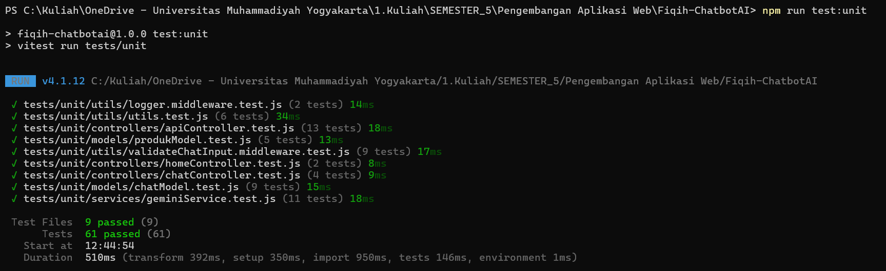
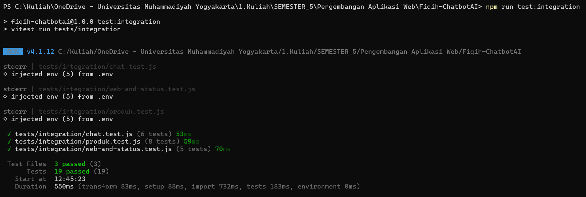
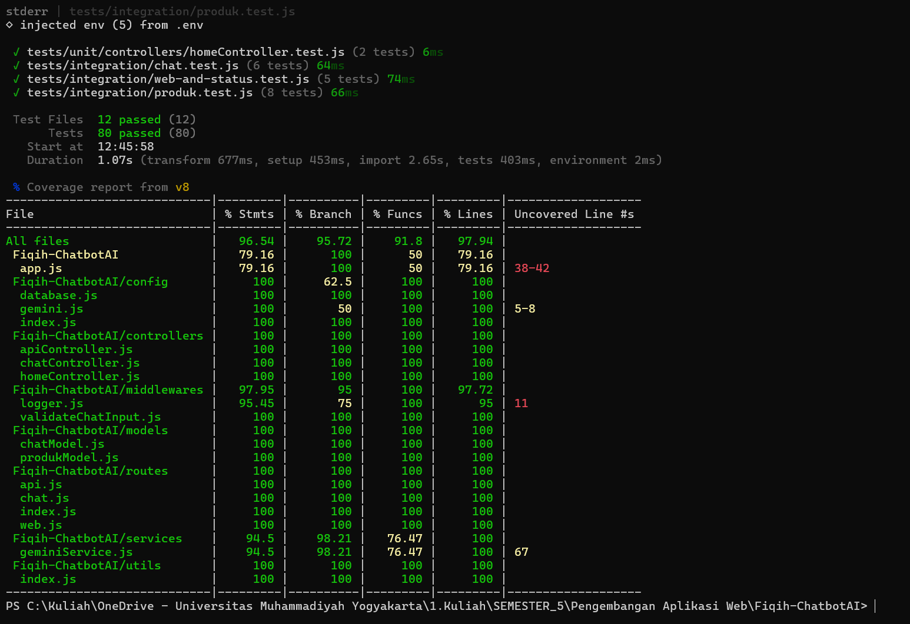

# Laporan Pengujian Otomatis — PPAW Week 11

> **Project:** FiqihAI (`Fiqih-ChatbotAI`) — Sistem Tanya Jawab & Rujukan Fiqih Kontemporer  
> **Kelas:** E (Kelompok 4)  
> **Topik:** Implementasi Unit Testing, Integration Testing, dan Code Coverage dengan Vitest & Supertest

---

## Ringkasan Implementasi Pengujian

Pengujian otomatis diimplementasikan menggunakan **Vitest**, **Supertest**, dan **@vitest/coverage-v8** dengan pendekatan mocking pada layer database (`pg`) serta layanan eksternal (`Google Gemini API`) agar pengujian berjalan cepat, terisolasi, dan tidak merusak data aplikasi utama.

### Struktur Folder Testing

```text
Fiqih-ChatbotAI/
├── tests/
│   ├── unit/
│   │   ├── controllers/
│   │   │   ├── apiController.test.js
│   │   │   ├── chatController.test.js
│   │   │   └── homeController.test.js
│   │   ├── models/
│   │   │   ├── chatModel.test.js
│   │   │   └── produkModel.test.js
│   │   ├── services/
│   │   │   └── geminiService.test.js
│   │   └── utils/
│   │       ├── logger.middleware.test.js
│   │       ├── utils.test.js
│   │       └── validateChatInput.middleware.test.js
│   ├── integration/
│   │   ├── chat.test.js
│   │   ├── produk.test.js
│   │   └── web-and-status.test.js
│   ├── fixtures/
│   │   ├── chat.js
│   │   └── produk.js
│   └── setup/
│       ├── test-app.js
│       └── test-setup.js
├── tugas/
│   ├── screenshot/
│   │   ├── 01-unit-testing.png
│   │   ├── 02-integration-testing.png
│   │   └── 03-code-coverage.png
│   └── week11-tugas.md
└── vitest.config.js
```

### Perintah Menjalankan Test

```bash
# Menjalankan seluruh unit & integration test
npm test

# Menjalankan unit test saja
npm run test:unit

# Menjalankan integration test saja
npm run test:integration

# Menjalankan seluruh test sekaligus pengukuran code coverage
npm run test:coverage
```

---

## Screenshot 1 — Unit Testing

Pengujian unit mencakup **9 file pengujian (61 test cases)** yang menguji secara terpisah:
- **Controllers:** `apiController`, `chatController`, `homeController` (kondisi normal & penanganan error).
- **Services:** `geminiService` (penyusunan konteks RAG, deduplikasi sumber, penanda `[[TIDAK_ADA]]`, batas `MAX_TOKENS`, fallback model saat `429/503`, timeout `AbortError`, dan validasi API key).
- **Models:** `produkModel` (CRUD query PostgreSQL) dan `chatModel` (tokenisasi, skor relevansi katalog, perluasan varian ejaan, pencarian `fatwa_chunk`, serta fallback error `42P01`).
- **Utils & Middlewares:** `utils/index.js` (`formatRupiah`, `formatTanggal`, `formatLogTerminal`), `middlewares/logger.js`, dan `middlewares/validateChatInput.js` (validasi input kosong/panjang, deteksi prompt injection, whitelist topik & sapaan, serta fallback pencarian katalog).



---

## Screenshot 2 — Integration Testing

Pengujian integrasi mencakup **3 file pengujian (19 test cases)** menggunakan **Supertest** yang menguji interaksi antarbagian aplikasi dari HTTP request hingga HTTP response:
- **CRUD Produk (`/api/produk`):** `GET /api/produk`, `GET /api/produk?format=array`, `GET /api/produk/:id` (200 & 404), `POST /api/produk` (201), `PUT /api/produk/:id` (200), `DELETE /api/produk/:id` (200), dan error database (500).
- **Fitur Chat AI (`POST /api/chat`):** Request chat → `validateChatInput` → `chatController` → `geminiService` → `ChatModel` & Gemini API → response JSON, termasuk validasi input kosong/kepanjangan (400), pemblokiran prompt injection & out-of-context, serta error layanan Gemini (502).
- **Web Routes, Status API & 404 Handler:** `GET /api/status`, render EJS `GET /` dan `GET /chat`, serta 404 handler untuk endpoint API maupun halaman web.



---

## Screenshot 3 — Code Coverage

Pengukuran code coverage dijalankan menggunakan provider `@vitest/coverage-v8` (`npm run test:coverage`) terhadap seluruh kode aplikasi (`app.js`, `config`, `controllers`, `middlewares`, `models`, `routes`, `services`, `utils`):

| Metrik Coverage | Persentase |
|---|---|
| **Statements** | **96.54%** |
| **Branches** | **95.72%** |
| **Functions** | **91.80%** |
| **Lines** | **97.94%** |


